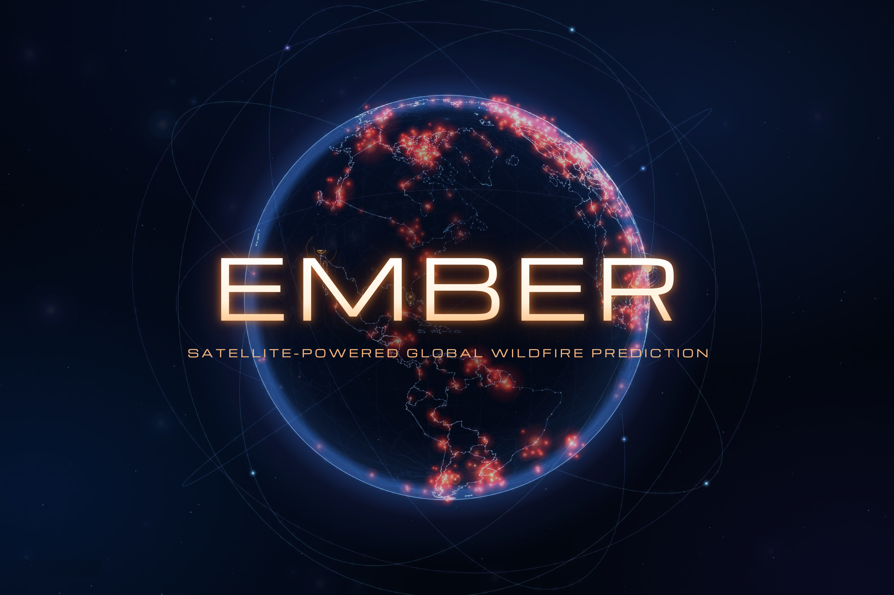

# EMBER: Satellite-powered global wildfire prediction

Detecting the presence of a fire isn't the same as predicting where it's most likely to move next and alerting to government officials to send evacuation orders to residents. Ember takes satellite data from GOES and VIIRS and updates its physics-based predictions every five minutes, alerting government officials of high-risk areas up to 2 hours ahead of how they acted during the Eaton fire in Southern California in 2025.

We were able to achieve significant results on 9 different regions, with our most promising backtest results issuing an alert in Pasadena E020 **118 minutes before any official alerts were sent out**. 

We can break down EMBER's process into three main steps:

1. Satellite fire detections (GOES every 5 minutes, VIIRS passes) arrive and are parsed and combined into one unified data layer.
2. A physics-based ensemble forecast of predictions, each with slightly different parameters, re-fits itself to each new observation and assigns a probability and expected hit time to each region.
3. The forecast becomes a visual map and a list of alerts letting the human know which areas are at risk.



## Try it at <https://linchangg.github.io/Ember/>!

- `/` is the globe. Click the Eaton Fire marker (or press **Take the guided tour**) to open the replay.
- Inside the replay, use the two sliders (actual time and forecast lead), the branch switcher (`main` with satellites and ground reports, `satellites-only`, `openloop`), the zones and alerts panel, and the "How early" tab, which compares each branch's first warning against the official evacuation times.

## Next Steps

Given the 36 hour time constraint, we've barely scratched the surface of what's possible for this model, and already uncovered extremely promising results. Just a glimpse into where we'd take this next:

* making it work in real time and update based on data every 5 minutes just how our originally scoped tool should work in production
* suggesting deployment maps for helicopters, firefighter units, and other firefighting methods
* allowing agentic actions after human approval; i.e., being able to press a button within Ember to actually deploy troops to certain locations that the algorithm has suggested
* full and seamless integration of many different types of natural disaster prediction
* fine-tuning our physics model for more accurate results and running tests on many, many more fires
* pitching our idea to VCs for potential funding

## What is in this repository

| Path | What |
|---|---|
| `web/` | The React + deck.gl front end: globe, replay dashboard, comparison pages |
| `engine/ember/` | Python engine: data ingestion (`data/`), the replay runtime, risk and alerts, notifications, AI briefings, and the `hazard/` ensemble and particle-filter adapter |
| `physics/surface_v1/` | Rust surface fire-spread solver used by the hazard adapter |
| `stdb/` | SpacetimeDB hub module (shared replay state) |
| `data/`, `fixtures/`, `config/` | Eaton scenario inputs, test fixtures, alert rules |
| `tools/`, `scripts/` | Checks and fixture builders |
| `SPEC.md`, `spec/`, `research/`, `docs/` | Build spec, shared contracts, research notes, phase reports and evidence |
| `design/` | Dashboard mockup and the cover image |

## Developing

You only need to run these commands if you want to change the code! Use Python 3.12 with `uv`, Node 22, and the Rust toolchain pinned in `physics/surface_v1/rust-toolchain.toml`.

```bash
# front end
cd web && npm install && npm run dev

# engine tests
uv sync --project engine --locked && uv run --project engine pytest
```

